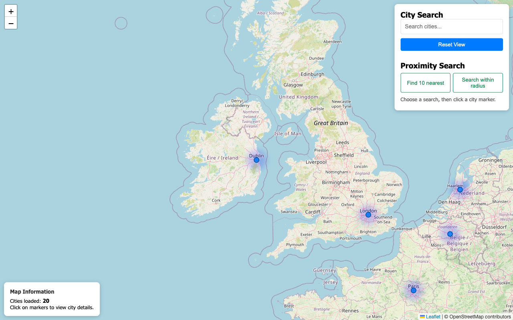
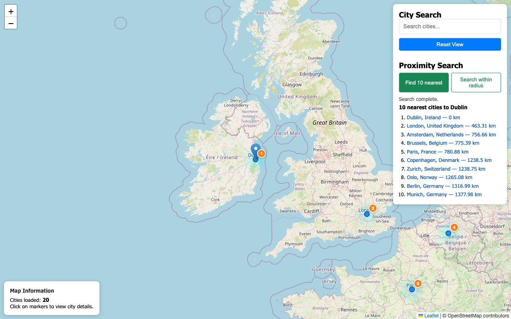
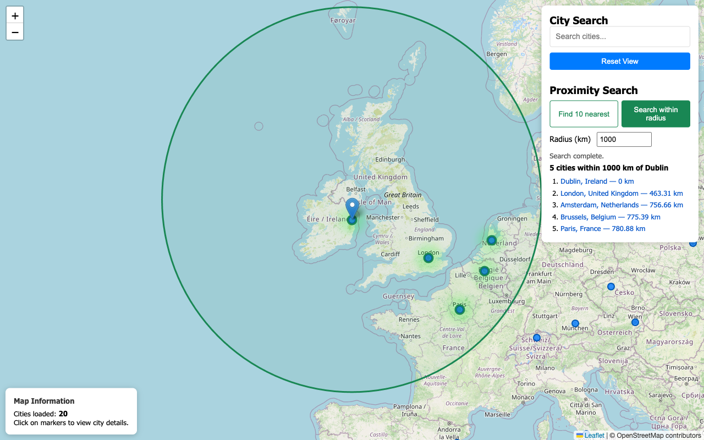
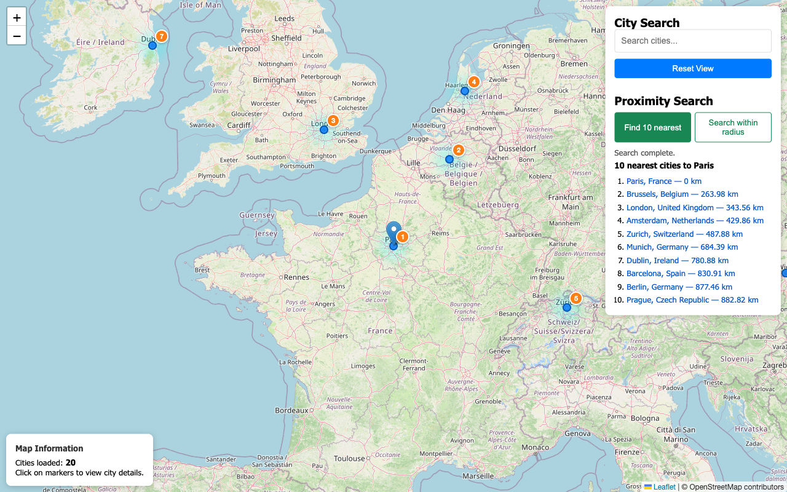
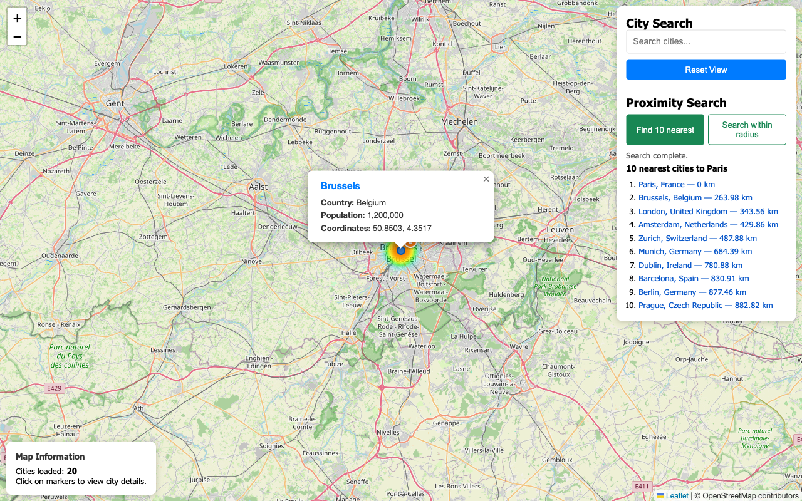

# Lab 5: Spatial Proximity Search with PostGIS and Django

Adds nearest-city and radius search to the Week 4 city map. Both searches use only the cities already stored in the `cities_api.City` table and compare them with PostGIS.

- `POST /api/cities/nearest/` returns the 10 nearest cities to `lat`/`lng`.
- `POST /api/cities/radius/` returns the cities within `radius_km` (default 100, maximum 20000) of `lat`/`lng`.
- On the map, choose **Find 10 nearest** or **Search within radius**, then click a city marker.

## Proof it works

### Task 1: API endpoints

Valid requests return existing API cities sorted from nearest to farthest. Invalid input returns HTTP 400.

```
$ curl -X POST http://localhost:8000/api/cities/nearest/ -H "Content-Type: application/json" -d '{"lat": 53.3498, "lng": -6.2603}'
{
    "search_point": {
        "lat": 53.3498,
        "lng": -6.2603
    },
    "total_found": 10,
    "nearest_cities": [
        {
            "id": 1,
            "name": "Dublin",
            "country": "Ireland",
            "population": 1400000,
            "coordinates": {
                "lat": 53.3498,
                "lng": -6.2603
            },
            "distance_km": 0.0,
            "rank": 1
        },
        {
            "id": 2,
            "name": "London",
            "country": "United Kingdom",
            "population": 9000000,
            "coordinates": {
                "lat": 51.5074,
                "lng": -0.1278
            },
            "distance_km": 463.31,
            "rank": 2
  ...

$ curl -X POST http://localhost:8000/api/cities/radius/ -H "Content-Type: application/json" -d '{"lat": 53.3498, "lng": -6.2603, "radius_km": 500}'
{
    "search_point": {
        "lat": 53.3498,
        "lng": -6.2603
    },
    "radius_km": 500.0,
    "total_found": 2,
    "cities": [
        {
            "id": 1,
            "name": "Dublin",
            "country": "Ireland",
            "population": 1400000,
            "coordinates": {
                "lat": 53.3498,
                "lng": -6.2603
            },
            "distance_km": 0.0
        },
        {
            "id": 2,
            "name": "London",
            "country": "United Kingdom",
            "population": 9000000,
            "coordinates": {
                "lat": 51.5074,
                "lng": -0.1278
            },
            "distance_km": 463.31
        }
    ]
}

$ curl -i -X POST http://localhost:8000/api/cities/nearest/ -H "Content-Type: application/json" -d '{"lat": 95, "lng": -6.2603}'
HTTP/1.1 400 Bad Request
{"error":"Latitude must be between -90 and 90 and longitude between -180 and 180."}


$ curl -i -X POST http://localhost:8000/api/cities/nearest/ -H "Content-Type: application/json" -d '{"lat": "north", "lng": -6.2603}'
HTTP/1.1 400 Bad Request
{"error":"Provide numeric lat and lng values."}


$ curl -i -X POST http://localhost:8000/api/cities/radius/ -H "Content-Type: application/json" -d '{"lat": 53.3498, "lng": -6.2603, "radius_km": -5}'
HTTP/1.1 400 Bad Request
{"error":"radius_km must be greater than 0 and no more than 20000."}
```

### Task 2: Proximity search on the map

Initial map with the full-city heatmap:



**Find 10 nearest**, then click Dublin. The 10 nearest cities show as numbered markers, the map centres on Dublin and the heatmap switches to the nearest palette:



**Search within radius**, 1000 km, then click Dublin. The 5 cities within 1000 km are listed, the map frames the 1000 km circle and the heatmap switches to the radius palette:



**Reset View** clears both result lists and the proximity overlays, restores the full-city heatmap and returns to the initial Dublin view:


The same search from another city (Paris) gives different results:



Clicking a result (Brussels) zooms to that city's marker:



### Part 4.3: Tests in the web container

```
$ docker compose run --rm web python manage.py test -v 2
Found 17 test(s).
System check identified no issues (0 silenced).
test_city_creation (cities_api.tests.test_api.CityAPITestCase.test_city_creation)
Test creating a new city ... ok
test_city_detail (cities_api.tests.test_api.CityAPITestCase.test_city_detail)
Test city detail endpoint ... ok
test_city_filtering (cities_api.tests.test_api.CityAPITestCase.test_city_filtering)
Test city filtering ... ok
test_city_list (cities_api.tests.test_api.CityAPITestCase.test_city_list)
Test city list endpoint ... ok
test_geojson_format (cities_api.tests.test_api.CityAPITestCase.test_geojson_format)
Test GeoJSON output ... ok
test_statistics_endpoint (cities_api.tests.test_api.CityAPITestCase.test_statistics_endpoint)
Test statistics endpoint ... ok
test_within_radius_query (cities_api.tests.test_api.CityAPITestCase.test_within_radius_query)
Test spatial within radius query ... ok
test_get_not_allowed (cities_api.tests.test_api.ProximitySearchAPITestCase.test_get_not_allowed) ... ok
test_invalid_coordinate_ranges_rejected (cities_api.tests.test_api.ProximitySearchAPITestCase.test_invalid_coordinate_ranges_rejected) ... ok
test_invalid_radius_rejected (cities_api.tests.test_api.ProximitySearchAPITestCase.test_invalid_radius_rejected) ... ok
test_missing_or_non_numeric_input_rejected (cities_api.tests.test_api.ProximitySearchAPITestCase.test_missing_or_non_numeric_input_rejected) ... ok
test_nearest_cities_limited_to_ten (cities_api.tests.test_api.ProximitySearchAPITestCase.test_nearest_cities_limited_to_ten) ... ok
test_nearest_cities_ordered_by_distance (cities_api.tests.test_api.ProximitySearchAPITestCase.test_nearest_cities_ordered_by_distance) ... ok
test_radius_defaults_to_100_km (cities_api.tests.test_api.ProximitySearchAPITestCase.test_radius_defaults_to_100_km) ... ok
test_radius_returns_only_cities_inside_radius (cities_api.tests.test_api.ProximitySearchAPITestCase.test_radius_returns_only_cities_inside_radius) ... ok
test_map_view_loads (tests.test_frontend.MapViewTests.test_map_view_loads)
Test that the map page loads successfully ... ok
test_static_files_served (tests.test_frontend.MapViewTests.test_static_files_served)
Test that static files are accessible ... ok

----------------------------------------------------------------------
Ran 17 tests in 1.219s

OK
```

### Task 3: Query timing

```
$ docker compose run --rm web python manage.py test_proximity_performance
Cities with locations: 20
Iterations per query: 50, radius: 1000 km
Dublin     nearest:   0.95 ms (10 results)   radius:   0.95 ms (5 results)
London     nearest:   1.04 ms (10 results)   radius:   1.05 ms (9 results)
Paris      nearest:   0.86 ms (10 results)   radius:   1.05 ms (10 results)
New York   nearest:   0.87 ms (10 results)   radius:   0.75 ms (0 results)
Tokyo      nearest:   0.85 ms (10 results)   radius:   0.75 ms (0 results)

Average nearest query: 0.92 ms
Average radius query:  0.91 ms
```

### How the measurements were taken

```bash
docker compose run --rm web python manage.py test_proximity_performance
```

The command (`cities_api/management/commands/test_proximity_performance.py`) runs the same querysets the API uses (`nearest_cities_queryset` and `cities_within_radius_queryset` in `cities_api/views.py`). It runs each query 50 times per test point, after one warm-up run, and prints `EXPLAIN ANALYZE` for Dublin.

### Average query times (Task 3)

| Test point | Nearest (10) | Radius 1000 km | Radius results |
|------------|-------------:|---------------:|---------------:|
| Dublin     | 0.92 ms | 0.90 ms | 5 |
| London     | 0.88 ms | 1.00 ms | 9 |
| Paris      | 0.96 ms | 1.00 ms | 10 |
| New York   | 0.85 ms | 0.85 ms | 0 |
| Tokyo      | 0.88 ms | 0.75 ms | 0 |
| **Average** | **0.90 ms** | **0.90 ms** | |

These times are round-trip ORM times from the web container to the db container. With only 20 rows, most of the time is query overhead, not spatial work. Repeated runs vary by roughly ±0.1 ms.

### Effect of `.only(...)`

Both proximity views now load only the fields the response uses (`id`, `name`, `country`, `population`, `location`) through `PROXIMITY_FIELDS`.

| | Row width in plan | Avg nearest | Avg radius 1000 km |
|---|---:|---:|---:|
| Before (all 12 columns) | 1249 bytes | 1.03 ms | 0.99 ms |
| After `.only(...)` | 688 bytes | 0.87 ms | 1.01 ms |

The API responses before and after the change were byte-for-byte identical for Dublin, Paris and New York. The ordered result IDs matched for all five test points. The timing difference is within noise at this dataset size. The smaller row width matters more as the table grows.

### Query plans

Nearest-city query (Dublin):

```
Limit  (actual time=0.108..0.111 rows=10 loops=1)
  ->  Sort  (actual time=0.107..0.108 rows=10 loops=1)
        Sort Key: (st_distance(geography(location), '...'::geography, false))
        Sort Method: quicksort  Memory: 27kB
        ->  Seq Scan on cities_api_city  (actual time=0.062..0.097 rows=20 loops=1)
              Filter: (location IS NOT NULL)
Execution Time: 0.224 ms
```

Radius query (Dublin, 1000 km):

```
Sort  (actual time=0.053..0.054 rows=5 loops=1)
  Sort Key: (st_distance(geography(location), '...'::geography, false))
  ->  Seq Scan on cities_api_city  (actual time=0.009..0.048 rows=5 loops=1)
        Filter: ((location IS NOT NULL) AND (st_distance(geography(location), '...'::geography, false) <= '1000000'::double precision))
        Rows Removed by Filter: 15
Execution Time: 0.066 ms
```

### Does the spatial index appear in the plan?

No. The GiST index `cities_api_city_location_5e706dd4_id` exists, and there is only one (checked with `\di cities_api_city*`). Neither query uses it, for two reasons:

1. The table is tiny. With 20 rows, a sequential scan is cheaper than any index lookup, so the planner picks it.
2. The SQL can't use the index for distance. `location` is a geographic (SRID 4326) geometry field. GeoDjango therefore turns `Distance(...)` and `distance_lte` into `ST_DistanceSphere`, which PostGIS runs as `st_distance(geography(location), ...)`. The plan computes this for every row and then sorts. A function result like this can't be looked up in a GiST index. Only index-aware operators can use the index: `&&`, `ST_DWithin`, or the KNN operator `<->` in `ORDER BY`.
