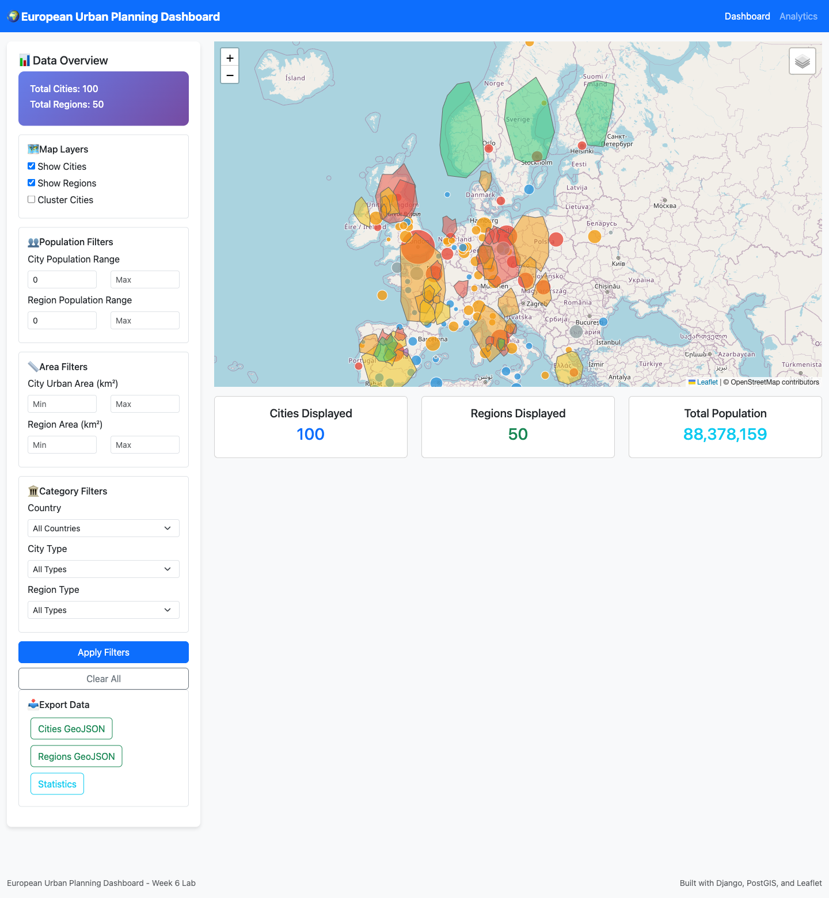
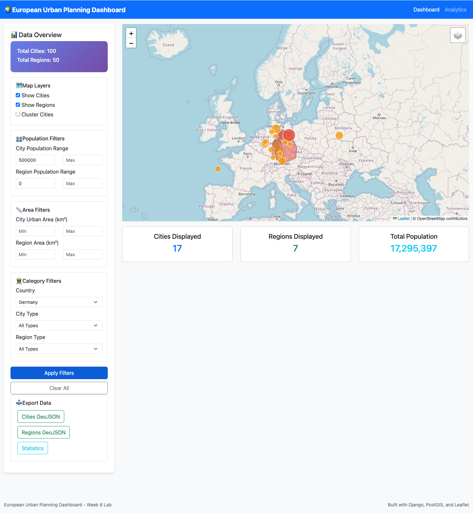
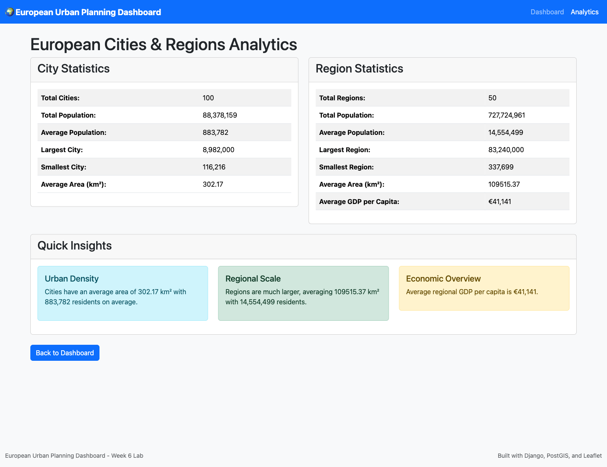

# Lab 6: Advanced GeoJSON REST API with Multi-Layer Filtering

## Step 4.4 – Test the Application

### Pages and endpoints

| Page                | URL                                        | Result |
|---------------------|--------------------------------------------|--------|
| Dashboard           | http://localhost:8000/                     | 200    |
| Analytics           | http://localhost:8000/analytics/           | 200    |
| Cities API          | http://localhost:8000/api/cities/          | 200    |
| Regions API         | http://localhost:8000/api/regions/         | 200    |
| City statistics     | http://localhost:8000/api/cities/statistics/  | 200 |
| Region statistics   | http://localhost:8000/api/regions/statistics/ | 200 |
| Django admin        | http://localhost:8000/admin/               | 302 (redirect to login) |
| pgAdmin             | http://localhost:5050                      | 302 (redirect to login) |

### Filter tests from the terminal

| Request | Features returned |
|---------|-------------------|
| `curl "http://localhost:8000/api/cities/?population_min=500000"` | 68 cities |
| `curl "http://localhost:8000/api/regions/?area_min=10000&country=Germany"` | 7 regions |
| `curl "http://localhost:8000/api/cities/?country=Germany&city_type=major&population_min=500000"` | 15 cities |
| `curl "http://localhost:8000/api/cities/nearby/?lat=53.3498&lng=-6.2603&distance=500"` | 13 cities within 500 km of Dublin |
| `curl -X POST http://localhost:8000/api/cities/within_bounds/ -H "Content-Type: application/json" -d '{"west": -11, "south": 50, "east": 2, "north": 59}'` | 12 cities in the Ireland/UK box |
| `curl -i "http://localhost:8000/api/cities/nearby/"` | `HTTP/1.1 400 Bad Request` – `{"error":"lat and lng parameters are required"}` |

Statistics endpoints:

```json
// /api/cities/statistics/
{"total_cities":100,"total_population":88378159,
 "population_stats":{"min":116216,"max":8982000,"avg":883781},
 "countries_count":19,
 "city_types_distribution":{"major":41,"regional":31,"capital":19,"town":9}}

// /api/regions/statistics/
{"total_regions":50,"total_population":727724961,"total_area_km2":5475768.47,
 "region_types_distribution":{"district":1,"state":28,"municipality":2,"country":19},
 "countries_count":19}
```

### Task 1 – Geometry types and filter effects

Both layers return a GeoJSON `FeatureCollection` with the expected geometry type:

| Endpoint        | Features | Geometry type          |
|-----------------|----------|------------------------|
| `/api/cities/`  | 100      | `Point` (100)          |
| `/api/regions/` | 50       | `MultiPolygon` (50)    |

Filters from the Step 2.3 parameter table and how they change the counts:

| Layer   | Filter                                      | Count (unfiltered → filtered) |
|---------|---------------------------------------------|-------------------------------|
| Cities  | `population_min=500000`                     | 100 → 68  |
| Cities  | `population_max=300000`                     | 100 → 14  |
| Cities  | `urban_area_min=200`                        | 100 → 56  |
| Cities  | `country=Germany`                           | 100 → 18  |
| Cities  | `city_type=capital`                         | 100 → 19  |
| Cities  | `country=Germany&population_min=500000`     | 100 → 17  |
| Regions | `population_min=10000000`                   | 50 → 18   |
| Regions | `area_min=10000`                            | 50 → 49   |
| Regions | `area_max=50000`                            | 50 → 26   |
| Regions | `country=Germany`                           | 50 → 7    |
| Regions | `region_type=state`                         | 50 → 28   |

Each filter narrows the result set, and combined filters are applied together (AND). Only the parameters listed in Step 2.3 are handled by the viewsets; other names such as `gdp_min` are ignored and return the full layer.

### Task 2 – Dashboard filters and export

1. Loaded the dashboard: 100 cities and 50 regions displayed.

   

2. Set **Country = Germany** and **City Population min = 500000**, then clicked **Apply Filters**. The map redrew both layers and the summary cards changed:

   | Card              | Before | After       |
   |-------------------|--------|-------------|
   | Cities Displayed  | 100    | 17          |
   | Regions Displayed | 50     | 7           |
   | Total Population  | 88,378,159 | 17,295,397 |

   The total matches the sum of `population` from `/api/cities/?country=Germany&population_min=500000`.

   

   Three of the 17 markers fall outside Germany (`City_1525`, `City_3841`, `City_8247`). These are filler cities that `populate_cities` creates with random names and coordinates to reach the requested count. Their `country` field is Germany, so the filter is behaving correctly.

3. Clicked **Clear All**: counts returned to 100 cities and 50 regions.

4. Clicked **Cities GeoJSON** export. The downloaded `cities_export.geojson` is a valid `FeatureCollection` of 100 features, each with a `Point` geometry (e.g. London `[-0.1278, 51.5074]`) and properties such as `name`, `country`, `city_type`, `population`, `gdp_per_capita`, `latitude`, `longitude`.

The analytics page shows a value in every field:



---

## Step 4.5 – Verify the Spatial Data in PostGIS

```bash
docker compose exec db sh -c \
  'PGPASSWORD="$POSTGRES_PASSWORD" psql -h localhost -U "$POSTGRES_USER" -d "$POSTGRES_DB" \
   -c "SELECT PostGIS_Version();" \
   -c "SELECT COUNT(*) AS cities, SUM(population) AS population FROM cities_city;" \
   -c "SELECT COUNT(*) AS regions FROM regions_region;" \
   -c "SELECT name, ST_AsText(location) FROM cities_city ORDER BY population DESC LIMIT 3;" \
   -c "SELECT GeometryType(geometry), ST_SRID(geometry) FROM regions_region LIMIT 1;"'
```

```
            postgis_version
---------------------------------------
 3.4 USE_GEOS=1 USE_PROJ=1 USE_STATS=1

 cities | population
--------+------------
    100 |   88378159

 regions
---------
      50

  name  |       st_astext
--------+------------------------
 London | POINT(-0.1278 51.5074)
 Berlin | POINT(13.405 52.52)
 Madrid | POINT(-3.7038 40.4168)

 geometrytype | st_srid
--------------+---------
 MULTIPOLYGON |    4326
```

The database counts match the API (100 cities, 88,378,159 people, 50 regions), and region geometries are stored as `MULTIPOLYGON` in WGS 84 (SRID 4326).

### Spatial indexes

```bash
docker compose exec db sh -c \
  'PGPASSWORD="$POSTGRES_PASSWORD" psql -h localhost -U "$POSTGRES_USER" -d "$POSTGRES_DB" \
   -c "SELECT tablename, indexname FROM pg_indexes WHERE tablename IN ('"'"'cities_city'"'"', '"'"'regions_region'"'"') ORDER BY 1, 2;"'
```

```
   tablename    |                       indexname
----------------+-------------------------------------------------------
 cities_city    | cities_city_city_ty_d8bb32_idx
 cities_city    | cities_city_country_6d703a_idx
 cities_city    | cities_city_location_34cfe5d6_id
 cities_city    | cities_city_name_country_e61a5a9a_uniq
 cities_city    | cities_city_pkey
 cities_city    | cities_city_populat_ca51b0_idx
 regions_region | regions_reg_area_km_069dac_idx
 regions_region | regions_reg_country_9e3f5f_idx
 regions_region | regions_reg_region__c3e806_idx
 regions_region | regions_reg_total_p_0d0154_idx
 regions_region | regions_region_centroid_ec4d40c4_id
 regions_region | regions_region_country_aa3b6413
 regions_region | regions_region_country_aa3b6413_like
 regions_region | regions_region_geometry_77791ffd_id
 regions_region | regions_region_name_9ca96ec3
 regions_region | regions_region_name_9ca96ec3_like
 regions_region | regions_region_name_country_region_type_fa10ac28_uniq
 regions_region | regions_region_parent_region_id_0c6de30f
 regions_region | regions_region_pkey
 regions_region | regions_region_region_code_a95c8a50_like
 regions_region | regions_region_region_code_key
(21 rows)
```

### Task 3 – Spatial (GiST) indexes

Filtering `pg_indexes` on `indexdef ILIKE '%gist%'` confirms which indexes are spatial:

| Table            | Column     | Index                                 | Definition |
|------------------|------------|---------------------------------------|------------|
| `cities_city`    | `location` | `cities_city_location_34cfe5d6_id`    | `USING gist (location)` |
| `regions_region` | `geometry` | `regions_region_geometry_77791ffd_id` | `USING gist (geometry)` |
| `regions_region` | `centroid` | `regions_region_centroid_ec4d40c4_id` | `USING gist (centroid)` |

Django creates these automatically for every `PointField` / `MultiPolygonField` (`spatial_index=True` is the default).

Why GiST helps
- A B-tree index sorts one-dimensional values. It can't answer "near this point" or "inside this box".
- A GiST index stores each geometry's bounding box in a tree. Each parent box encloses its children's boxes.
- A query walks down only the branches whose boxes touch the search area and skips the rest of the table.
- Nearby endpoint: the index finds the cities whose boxes fall within the radius envelope. Exact distances are then calculated only for those candidates, not for every row.
- Bounding-box endpoint: the && box-overlap test matches the boxes the index stores, so cities outside the box are rejected at the index level.
- Overall, a full table scan becomes a logarithmic lookup. The gain matters as the table grows. With 100 rows, PostgreSQL may still choose a sequential scan.
---
